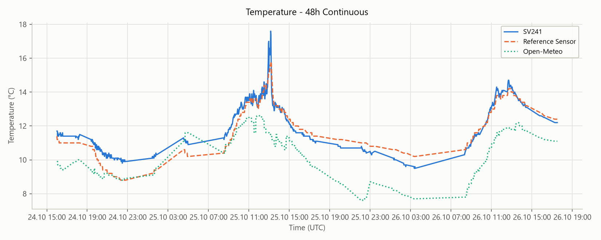
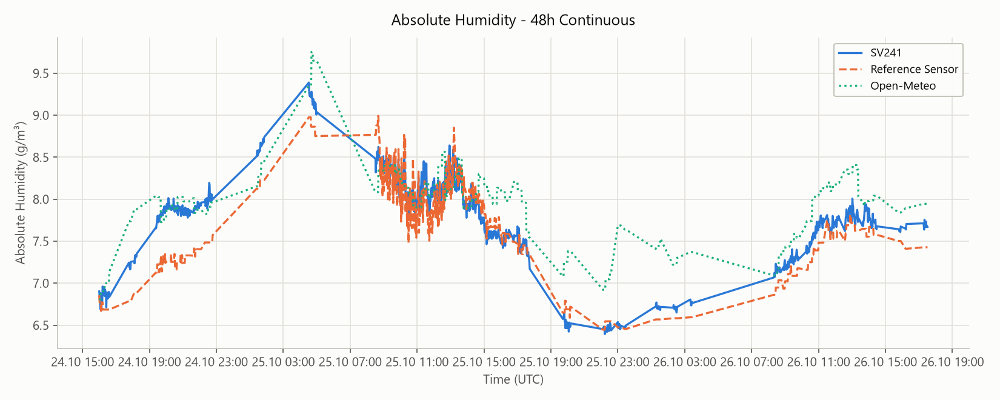

# Sensor Accuracy Validation (SHT40 Temp/Humidity)

[← Back to main readme](../readme.md)

A report on issue #9 described the SV241's ambient temperature/humidity reading drifting away
from a calibrated reference sensor during the morning transition - in the reported case, by as
much as 10-11°C and 15-16 percentage points of relative humidity. This document records an
independent validation: comparing the SV241's own SHT40 reading against an unrelated physical
reference sensor and against Open-Meteo, continuously over 48 hours, with full methodology and raw
data so the measurement can be reproduced by anyone.

**Note:** the setup used for this validation is not the same physical unit or location as the
original report - this does not reproduce or explain that specific report. It establishes whether
the SV241's general measurement approach is sound under controlled, independently-verified
conditions.

## Test Setup

- **SV241 under test:** running in an outdoor enclosure (the normal use case), logging its own
  SHT40 ambient temperature/humidity via the built-in [telemetry system](./TELEMETRY.md).
- **Reference sensor:** an independent temperature/humidity sensor, physically placed outdoors
  near the SV241, polled via a local home-automation system. Referred to generically below ("the
  reference") - the specific hardware/integration isn't relevant to the result.
- **Open-Meteo:** pulled in via the proxy's optional weather-logging feature
  (`logWeatherToTelemetry`, see [Configuration Reference](./CONFIGURATION_REFERENCE.md)) as a
  *second*, independently-computed data point - not as the primary reference. Open-Meteo's
  `current` field is not a live reading; it reflects the most recent hourly model step, which can
  trail true conditions by up to about an hour (visible as the stair-stepped Open-Meteo line in the
  charts below, and as a larger, more lagged delta than the direct reference comparison). Treat it
  as corroborating evidence only.
- **Window:** 48 continuous hours, spanning a calm night, a full day with a fast morning warm-up,
  a second night, and a second morning warm-up - no cherry-picked windows, no gaps in coverage.

## Methodology

- **Absolute humidity, not relative humidity.** Relative humidity is temperature-dependent - two
  sensors reading different temperatures will show different %RH even with identical actual water
  vapor content, purely from psychrometrics. Comparing relative humidity directly overstates
  disagreement between sensors that are a priori at slightly different temperatures. Absolute
  humidity (grams of water vapor per m³) removes that coupling and is computed from each sensor's
  own temperature + relative humidity via the Magnus formula:

  ```
  e_sat = 6.112 * exp((17.62 * T) / (243.12 + T))   // saturation vapor pressure, hPa
  e     = (RH / 100) * e_sat                         // actual vapor pressure, hPa
  abs_humidity = (216.7 * e) / (T + 273.15)          // g/m³
  ```

- **Time alignment.** The reference sensor only reports on state change, so its readings are
  sparser than the SV241's telemetry. Each SV241 sample is paired with the most recent reference
  reading at or before it ("forward-fill"); pairs more than 30 minutes apart are **dropped** rather
  than paired with a stale value. This is why the aligned row count (955) is lower than the raw
  sample count returned by the history API, and why very stable stretches contribute fewer points -
  the reference simply didn't report often enough there to stay within the 30-minute window.
- **The SV241 history API thins its response to roughly 2000 points for a query this wide** (every
  Nth raw sample, see `HandleGetHistory` in `internal/telemetry/api.go`) - the underlying database
  still holds the full-resolution log; this only affects what a single API call returns. At every
  Nth sample the data is still far denser than the reference's own change-triggered reporting, so
  it doesn't materially affect the alignment or the statistics below.
- **All joins use raw UNIX timestamps**, not local time strings - this keeps the comparison correct
  across the DST transition that occurred during the window.

## Results

| Metric | vs. Reference | vs. Open-Meteo |
|---|---|---|
| Aligned samples | 955 | 955 |
| Temp delta - mean | +0.19°C | +1.64°C |
| Temp delta - range | -1.20 to +2.00°C | -0.70 to +6.10°C |
| Abs. humidity delta - mean | +0.16 g/m³ | -0.23 g/m³ |
| Abs. humidity delta - range | -0.52 to +0.76 g/m³ | -1.23 to +0.55 g/m³ |
| Outliers (\|Δ\| > 3°C or 3 g/m³) | 0 | 0 |
| Temp delta sign flips | 33 | - |




The temperature delta against the reference crosses zero 33 times over the 48h window - expected
given two full diurnal cycles with varying rates of change, not a sign of a measurement problem,
since the magnitude stays small throughout.

One brief exception is visible in the temperature chart around midday on the first full day: the
SV241 reading spikes to 17.6°C for a few minutes (reference: 15.6-15.8°C, a 2.0°C delta - the
single largest deviation in the whole window) before settling back down within about four minutes.
Plausible explanation is a brief direct-sun exposure on the sensor/enclosure; it's narrow, isolated,
and still inside the "no extreme outlier" band used above, so it doesn't change the overall
picture - but it's left visible in the chart and data rather than smoothed over.

The much larger, more variable delta against Open-Meteo (up to 6.1°C, coinciding with that same
brief spike) is consistent with its hourly update/lag characteristic rather than a SV241
measurement issue - Open-Meteo simply hadn't caught up to either sensor's real-time value at that
moment.

## Conclusion

Across a full 48-hour, gap-free window - two nights and two fast morning warm-ups, exactly the kind
of transition the original report described - the SV241's SHT40 reading tracked an independent
reference within roughly ±1.2°C and ±0.8 g/m³ absolute humidity, with only one brief, narrow,
self-correcting exception, and zero sustained outliers. This does not reproduce or explain the
specific report in issue #9, but it does show the SV241's general measurement approach holding up
under independently-verified, continuous conditions.

## Reproducing This Yourself

1. Enable **Log Weather Data to Telemetry** in Proxy Settings (`logWeatherToTelemetry`) if you want
   an Open-Meteo cross-check alongside your own reference - see
   [Configuration Reference](./CONFIGURATION_REFERENCE.md).
2. Set up your own independent temperature/humidity reference near the SV241 (any sensor you trust,
   polled independently of the SV241 itself).
3. Pull SV241 history via `GET /api/v1/telemetry/history?start={unix}&end={unix}` (see
   [REST API & Automation](./REST_API.md)) - or use the **Data Explorer**'s CSV export in the web
   UI for a quick manual comparison.
4. Pull your reference's history for the same window from wherever it's logged.
5. Align both time series (forward-fill is simplest if your reference is change-triggered; drop
   pairs that are too far apart in time to trust).
6. Compute absolute humidity for both sources with the Magnus formula above, and compare that
   instead of relative humidity directly.

Raw data for the full 48h run is included for reference: [raw_data_48h.csv](./media/raw_data_48h.csv).
